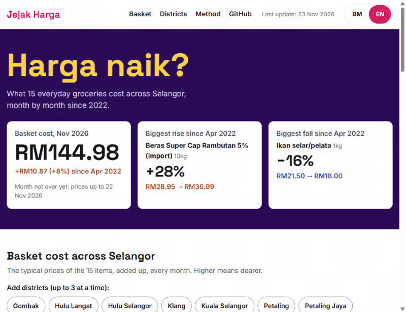

# Jejak Harga

*Harga naik? Follow what your basket costs, district by district, since 2022.*

**Live site: [hrithikhwn.github.io/jejak-harga](https://hrithikhwn.github.io/jejak-harga/)** · in Bahasa Melayu and English · refreshed every day



Jejak Harga tracks what a basket of 15 everyday groceries costs across Selangor, every month since January 2022. It's built on KPDN's PriceCatcher data: over 130 million prices reported by shops around Malaysia since 2022. The official PriceCatcher app shows today's prices; this site shows how they've changed, and how districts compare.

On the site you can:

- see this month's basket cost, and the items that rose and fell most since April 2022
- follow the basket month by month, add district lines and the official food CPI, with major price events marked on the chart
- switch items out of the basket and watch the totals change
- compare districts, with the reason whenever a district has too few shops to show

## Three findings

Figures as of November 2026. The site's numbers update every day.

1. **Imported rice rose 35% in a year.** A 10kg bag of Beras Super Cap Rambutan 5% (import) cost RM29.90 in April 2023 and RM40.49 in April 2024. Bernas had raised the price of imported white rice by 36% on 1 September 2023 ([The Star](https://www.thestar.com.my/news/nation/2023/09/01/price-of-imported-white-rice-up-by-36-says-bernas)). In November 2026 the bag was still 28% dearer than in April 2022.
2. **Bottled cooking oil jumped when its subsidy ended.** A 2kg bottle of Cap Buruh cooking oil cost RM12.70 in June 2022. The subsidy for bottled cooking oil ended on 1 July 2022 ([Malay Mail](https://www.malaymail.com/news/malaysia/2022/06/22/pm-govt-to-continue-subsidy-for-cooking-oil-in-plastic-packets-only-bottled-stopped/13653)), and the bottle cost RM17.40 in July 2022 before easing to RM13.50 by October 2022.
3. **Klang's basket is cheaper almost every month.** In 57 of the 58 months with enough shops there, the basket cost less in Klang than across Selangor as a whole, typically by RM5.20 (3.6%) ([Districts tab](https://hrithikhwn.github.io/jejak-harga/#districts)). That may reflect which shops report in Klang as well as cheaper shopping.

## How it works

- **Method.** Each shop gets one price per item per month (the median of its prices), so a shop that reports every day doesn't outweigh one that reports weekly. An item's typical price is the median across shops, for Selangor and for each district. The basket adds up the 15 typical prices, one of each, and a price only counts when at least 3 shops priced the item.
- **Pipeline.** Python and DuckDB. [`pipeline/build.py`](pipeline/build.py) runs the SQL in [`pipeline/sql/`](pipeline/sql/) to load, check and summarise the data, then writes small JSON files for the site.
- **Site.** React (Vite) and Recharts in [`site/`](site/), in Bahasa Melayu and English, hosted on GitHub Pages.
- **Daily refresh.** Every evening at 9:17pm Malaysia time, [a GitHub Actions workflow](.github/workflows/refresh.yml) refreshes the last two months, runs the data checks, commits the new data and redeploys the site. If a check fails, nothing is published.

More detail: the plan and decisions in [ROADMAP.md](ROADMAP.md), the site design in [WEB_UI.md](WEB_UI.md), and the data quirks behind the method in [explore/NOTES.md](explore/NOTES.md).

## Run it yourself

You need Python 3.14 and Node.js 24. From the repo folder:

```sh
pip install -r requirements.txt
python pipeline/build.py --full
pytest
```

`--full` downloads every month since January 2022 (about 160 MB) and rebuilds `data/` and `site/public/data/`. Without it, only the last two months are refreshed. `pytest` runs the data checks.

Then the site:

```sh
cd site
npm ci
npm run dev
```

It opens at http://localhost:5173/jejak-harga/. `npm run build` runs the site's tests and builds it into `site/dist/`.

## Limitations

- PriceCatcher is collected to monitor prices. DOSM says it should complement the CPI, not replace it, and it isn't meant for measuring inflation. This site shows basket costs, not an inflation rate.
- Prices are typical (median) prices across the shops that reported, and the set of shops that reports changes over time.
- District costs only appear in months when every basket item has at least 3 shops in that district, so smaller districts have gaps. Kuala Langat and Rawang never qualify.
- Fresh produce swings a lot from month to month, so compare trends rather than two single months.
- The current month is partial until it ends.
- Some prices are dropped before anything is added up: 1.1% of all prices since 2022 are for item codes missing from PriceCatcher's item list, and 429 come from shops missing from its shop list. The site reports these counts.
- This version covers Selangor only. Other states are planned; Sabah, Sarawak and Labuan can't use this basket because its rice isn't sold there.

## Data and credits

Prices from KPDN's [PriceCatcher](https://open.dosm.gov.my/data-catalogue/pricecatcher) and the food CPI from DOSM's [Consumer Price Index by state](https://open.dosm.gov.my/data-catalogue/cpi_state), via [OpenDOSM](https://open.dosm.gov.my), used under [CC BY 4.0](https://creativecommons.org/licenses/by/4.0/). The figures here are calculated from that data (medians and basket totals) and aren't official statistics.

Jejak Harga is an independent project, not affiliated with or endorsed by KPDN or DOSM.

The code is under the [MIT License](LICENSE).
